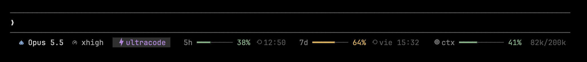

# Dotfiles

This repository contains my personal dotfiles and configuration settings for various tools I use across different systems.

## Repository map

```text
bin/          Commands available outside tmux, including cafe-on/off/status
agents/       Rules and demo helpers shared by Claude, Codex and opencode
zsh/          Shell configuration and prompt theme
git/          Shared Git preferences and global ignore patterns
vim/          Vim settings
tmux/         tmux config, layout, attention integration and status indicators
ghostty/      Ghostty settings
claude/       Claude-specific hooks and status line
opencode/     opencode-specific plugins
rectangle/    Window-management settings to import manually
hosts/        Base host entries and the explicit hosts updater
examples/     Templates for local overrides; personal values stay untracked
scripts/      Installation helpers
tests/        Installation checks using temporary homes
docs/         Screenshots and installation/recovery documentation
deck/         Separate dashboard checkout, ignored by this repository
private/      Optional private checkout, also ignored
```

The root keeps the entry point (`install.sh`), package list (`Brewfile`), README and repository maintenance files (`.github/`, `.githooks/`, `.gitignore`, `.gitleaks.toml`). `agents/AGENTS.md` is shared agent configuration; it is not the instructions file for maintaining this repository.

Source locations differ from installed paths. For example, `zsh/zshrc` links to `~/.zshrc`, `git/gitconfig` is included by Git, and `bin/cafe.py` links to the three `~/.local/bin/cafe-*` commands. Files in `tmux/status/` keep their existing `~/.tmux/` command paths. See [all installed paths](docs/installation.md#installed-paths).

## Installation

Clone this repo into `~/dotfiles`. Install Homebrew separately if needed, then choose an action:

```sh
./install.sh --dependencies  # install missing packages, plugins, agents and deck
./install.sh                 # apply configuration only (same as --config)
./install.sh --all           # dependencies, then configuration
./install.sh --update        # explicitly upgrade packages, plugins and deck
./install.sh --hosts         # explicitly replace /etc/hosts after confirmation
```

The default action needs Git and Python 3. It does not download or upgrade software and does not change `/etc/hosts`. Installing dependencies needs Homebrew and network access; package compatibility depends on your macOS version. `--update` does not update this dotfiles checkout itself; pull its changes separately, then run `--config`.

Configuration creates or repairs links for Zsh, Vim, tmux, Ghostty and agents, merges Claude's hooks without removing other settings, and includes the shared Git preferences without changing your name, email or signing key. Existing files and changed links are backed up under `~/.local/state/dotfiles/backups/`. See [installation and recovery](docs/installation.md).

Existing `~/.zshrc.local` and `~/.hosts.local` are kept, including links into an older checkout. When absent, local files are created in this checkout and linked into your home. These files are ignored by Git. Local shell overrides load last. Import `rectangle/RectangleConfig.json` manually from Rectangle if desired.

When `pinentry-mac` is available and no pinentry program is already configured, configuration adds it to `~/.gnupg/gpg-agent.conf`. At the first GPG password prompt, select **Save in Keychain**; allow future access if macOS asks. Existing GPG program, identity and key settings are kept.

If a private checkout is present, its installer runs last. The deck's four commands are linked when a deck checkout is present; use `--dependencies` to download it first.

## Zsh Plugins

This setup includes the following Zsh plugins:

- **[zsh-autosuggestions](https://github.com/zsh-users/zsh-autosuggestions)**: Suggests commands as you type.
- **[zsh-syntax-highlighting](https://github.com/zsh-users/zsh-syntax-highlighting)**: Highlights syntax as you type commands in the terminal.
- **[zsh-fzf-history-search](https://github.com/joshskidmore/zsh-fzf-history-search)**: Fuzzy search through your Zsh history.

These plugins are installed by `./install.sh --dependencies` and updated by `--update`.

## tmux attention indicator

When something needs you in a window you're not looking at, the tmux status bar shows an icon next to that window's name: a bell when it finished, a question mark when it's asking for permission or input. Visiting the window clears it.

- **Claude Code**: hooks in `claude/hooks.json`.
- **opencode**: plugin in `opencode/plugins/attention.js`.
- **zsh**: a command finishes while you're on another window (`zsh/zshrc`).
- **Anything else**: any terminal bell (e.g. `make test; printf '\a'`).

All of them call `~/.tmux/attention.sh done|ask`. After installing, restart running opencode sessions and `source ~/.zshrc` in open shells.

## Keeping the Mac awake (`cafe-on`)

`cafe-on`, `cafe-off` and `cafe-status` (`bin/cafe.py`, linked in `~/.local/bin` so agents' shells find them without `.zshrc`) keep the Mac awake while agents work, without one agent's `cafe-off` letting the Mac sleep under another that's still working:

- **From an agent** (Claude Code, opencode or Codex, found by walking up its process tree): `cafe-on` starts that agent's own `caffeinate -dims` and `cafe-off` stops only that one. macOS sleeps only once no caffeinate is left, so another agent's keeps it awake. An agent's caffeinate is tied to it (`-w`), so it also ends when the agent does, even without `cafe-off`.
- **From your own shell**: `cafe-on` and `cafe-off` switch the persistent one, as before (the launchd job `com.santiago.caffeinate`), until `cafe-off`.
- `cafe-off --all` turns everything off, agents' included (say, before leaving on battery).
- `cafe-status` lists what keeps it awake: the persistent one, and each agent's tmux window and since when. `~/.cache/cafe` keeps a file per agent.
- The tmux status bar shows the coffee icon while any of them is on: alone for your persistent one, `☕ 2` for two agents, `☕ +2` for yours and two agents. `cafe-on` and `cafe-off` redraw it at once.

## Home dashboard (deck)

The tmux home dashboard, in window 0, is a repo of its own: [deck](https://github.com/GuillenSanti/deck). `--dependencies` clones it into `deck/`, `--update` updates it, and `--config` links `~/.tmux/dash.py` and its other commands. What it relies on stays here: the attention indicator above (agents asking or done), the `prefix R` binding that reviews a PR, OSC 8 hyperlinks in `tmux/tmux.conf`, and the tmuxp layout that opens it in window 0.

## Keeping it public

Whatever only makes sense on one machine or at one job goes in `private/`, a private repo of its own cloned there (git ignores it here): the deck's Slots card, the real tmuxp layout (`tmux/main.yaml` is a plain one), a `.zshrc.local` template, and the words that mustn't leave it. `private/install.sh` links its parts into place, and `install.sh` runs it last.

`gitleaks` keeps the rest clean. `.githooks/pre-commit` stops a commit that adds a secret, a path into a home folder or one of those words outside `private/` (with `private/gitleaks.toml`, which adds the words to `.gitleaks.toml`, when it's there), and the `gitleaks` workflow scans the files with `.gitleaks.toml` on every push. A line that only looks like a secret says `gitleaks:allow`.

The local hook also blocks commits when gitleaks is missing; install it with `brew install gitleaks` before retrying. GitHub's scan happens after a push and cannot prevent the initial upload of a secret.

## Global agent rules

`agents/AGENTS.md` holds the rules every coding agent follows in any project: git and PR workflow, commit messages, keeping the Mac awake with `cafe-on`/`cafe-off`, scope, comments and security. opencode reads it as `~/.config/agents/AGENTS.md`, Claude Code as `~/.claude/CLAUDE.md` and Codex as `~/.codex/AGENTS.md`, all linked to the same file, so editing it changes all three. When a project's own instructions say something different, the project wins. Changes apply to new sessions.

## Claude Code status line

`claude/statusline.py` draws Claude Code's status line in the dashboard's style, under the prompt (here with made-up numbers):



- **Left**: the model, its effort level, a purple *ultracode* tag only while ultracode is on, and the 5-hour and weekly limits (green, yellow from 50%, red from 80%) with when they reset.
- **Right**, at the pane's edge: how much of the context window the session uses, and its tokens. The width comes from tmux (`TMUX_PANE`), else from the terminal.
- **Ultracode** isn't in the JSON Claude Code passes to the status line, so it's read from the session's transcript: the last `ultra_effort_enter`/`ultra_effort_exit` marker Claude Code writes on each prompt, or `/effort`'s own "Ultracode on/off" output, found with `rg` (transcripts reach hundreds of MB). The `ultracode` keyword in a single prompt doesn't count: it's for that turn only.

## Ghostty

`ghostty/config.ghostty` is linked to `~/Library/Application Support/com.mitchellh.ghostty/config.ghostty`, where Ghostty reads it on macOS. It leaves as little as possible around the terminal while keeping the window buttons:

- **Title bar**: the `tabs` style puts the tabs in the title bar, next to the window buttons, so there's a single bar and the window can still be dragged by it. No title and no proxy icon.
- **Padding**: none above or below, and 4 points at the sides. `window-padding-balance` is off, so the space left over from the cell grid goes to the right and bottom edges instead of above the first line, which starts right under the tab bar.
- **Look**: Dracula on a pure black background, JetBrains Mono, and the X-ray icon.

After editing, reload it with ⌘⇧,. A change of title bar style only applies to new windows.

## Customization

You can customize the following files:

- **~/.zshrc**: The main Zsh configuration file.
- **~/.vimrc**: Vim configuration file.
- **~/.gitignore_global**: A global Git ignore file for excluding files from version control.
- **~/.zshrc.local**: A file for machine-specific configurations (e.g., environment variables or aliases).
- **~/.hosts.local**: A file for machine-specific host configurations (e.g., IP-to-hostname mappings).

If you're using multiple systems (work, personal, etc.), the `~/.zshrc.local` and `~/.hosts.local` files allow you to specify custom settings for each machine.

## Homebrew packages

`Brewfile` lists every Homebrew package and app to install, grouped by what it's for. `--dependencies` installs missing packages without upgrading existing ones; `--update` runs `brew bundle` with upgrades enabled. To add one, add its `brew` or `cask` line and run:

```bash
brew bundle --file=~/dotfiles/Brewfile
```

- **What's missing:** `brew bundle check --file=~/dotfiles/Brewfile --no-upgrade` says whether everything in it is installed.
- **What's not in it:** `brew bundle cleanup --file=~/dotfiles/Brewfile` lists what's installed but not in the Brewfile, so you can add it. With `--force` it uninstalls it instead.
- **An app already installed outside Homebrew:** its `cask` line fails because the app is already in `/Applications`. `brew install --cask --adopt <cask>` hands it over to Homebrew.

## Managing Updates

To update your dotfiles on your machine, follow these steps:

1. **Pull the latest changes from the repository**:

    ```bash
    git pull --ff-only origin main
    ```

2. **Apply the configuration** (run `--dependencies` first if new packages were added):

    ```bash
    ./install.sh
    ```

## Troubleshooting

See [installation and recovery](docs/installation.md) for backups, local overrides, Git settings and verification. Installation errors stop the requested action; resolve them before rerunning it. The script never upgrades macOS automatically.

## License

Feel free to fork, clone, and use these dotfiles for your own setups.
